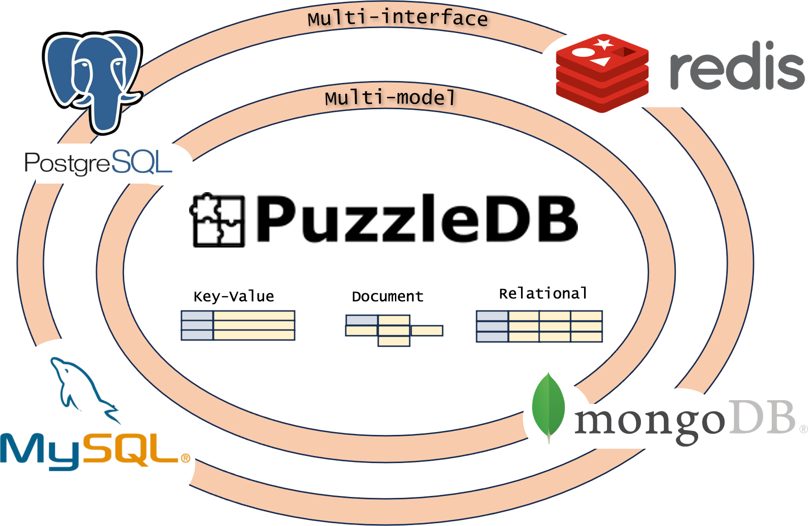
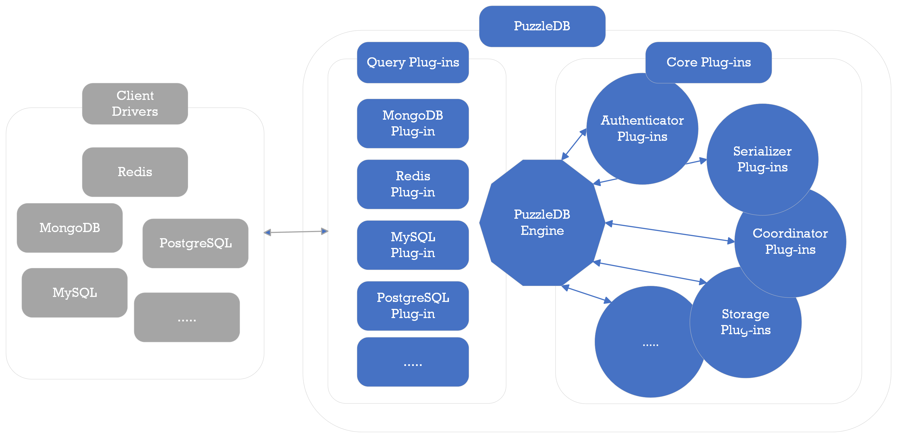
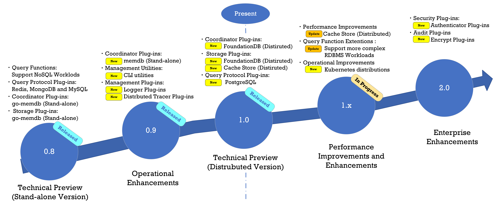

<figure>

</figure>

 [](https://github.com/cybergarage/puzzledb-go/actions/workflows/make.yml) [](https://pkg.go.dev/github.com/cybergarage/puzzledb-go) [](https://goreportcard.com/report/github.com/cybergarage/puzzledb-go) [](https://codecov.io/gh/cybergarage/puzzledb-go)

# PuzzleDB for Go

PuzzleDB is a **technology preview** of a multi-protocol, multi-model database implemented in Go. It explores how PostgreSQL, MySQL, Redis, and MongoDB protocol frontends can share database services through a modular plugin architecture.

Use it to experiment with database internals, protocol adapters, and storage backends. Protocol support is incremental: accepting a client connection does not imply full query, command, transaction, or behavioral compatibility with the original database. This preview does not establish production readiness or performance guarantees.

## Features and architecture

- Query plugins implement PostgreSQL, MySQL, Redis, and MongoDB protocol frontends.
- Data-model and encoding layers support work on key-value, relational, and document data.
- Storage and coordination plugins include in-memory and FoundationDB implementations.
- Additional plugin services cover authentication, caching, metrics, and tracing.
- Server and CLI entrypoints live in [`cmd/`](cmd/); core services and plugins live in [`puzzledb/`](puzzledb/).



Requests enter through a protocol plugin and use shared model, encoding, and storage interfaces. The plugin boundaries allow backends and supporting services to evolve independently. Storage durability and transaction behavior depend on the selected backend and configuration; do not assume identical semantics across protocols.



## Quick start

With Docker installed, run the preview locally:

```sh
docker run --rm -it \
  -p 127.0.0.1:6379:6379 \
  -p 127.0.0.1:27017:27017 \
  -p 127.0.0.1:3306:3306 \
  -p 127.0.0.1:5432:5432 \
  cybergarage/puzzledb:latest
```

In another terminal, try the Redis frontend with `redis-cli` installed:

```sh
redis-cli -h 127.0.0.1 -p 6379 SET mykey "Hello"
redis-cli -h 127.0.0.1 -p 6379 GET mykey
```

This disposable container is for exploration. See [configuration](doc/configuring.md) before choosing storage or persistence settings. The [quick start](doc/quick-start.md) includes SQL and document examples.

### Build from source

Use Go 1.25.0 or later, a C toolchain, and the FoundationDB client headers and library required by the Go bindings. The server imports FoundationDB plugins even when you intend to select an in-memory backend. See [`scripts/fdb_install`](scripts/fdb_install) and the platform build guides below for setup context.

```sh
git clone https://github.com/cybergarage/puzzledb-go.git
cd puzzledb-go
go build ./cmd/puzzledb-server ./cmd/puzzledb-cli
go run ./cmd/puzzledb-server
```

### Protocol scope

Check the protocol-specific documentation before trying a workload:

| Frontend | Support details |
| --- | --- |
| PostgreSQL | [Queries and compatibility](doc/postgresql.md) |
| MySQL | [Queries and compatibility](doc/mysql.md) |
| Redis | [Commands and compatibility](doc/redis.md) |
| MongoDB | [Commands and compatibility](doc/mongodb.md) |

## Development and testing

After installing the build dependencies, run the Go suites directly:

```sh
go test -v -p 1 -timeout 60m ./puzzledb/... ./puzzledbtest/...
```

Integration suites may require backend services and test certificates; see [`puzzledbtest/`](puzzledbtest/) and [`puzzledbtest/certs/Makefile`](puzzledbtest/certs/Makefile). The repository's `make unittest` target also generates coverage reports. `make test` includes formatting and linting; its formatting prerequisite regenerates and commits the version file, so review the [Makefile](Makefile) before using it in a working checkout.

## Architecture and design guides

- [Design concepts](doc/concept.md) and [layers](doc/layer-concept.md)
- [Data model](doc/data-model.md) and [storage](doc/storage-concept.md)
- [Consistency](doc/consistency-model.md) and [coordination](doc/coordinator-concept.md)
- [Authentication](doc/auth-concept.md) and [plugins](doc/plugin-concept.md)

## Roadmap and limitations

The distributed plugin stack is under development. The roadmap describes direction rather than a promise that every illustrated capability is complete. Evaluate supported operations, failure behavior, and persistence for your own experiments.



# User Guides

- Get Started

  - [Quick Start](doc/quick-start.md)

    - [puzzledb-server](doc/cmd/server/puzzledb-server.md)

  - [Configuring PuzzleDB](doc/configuring.md)

- Operation

  - [CLI (puzzledb-cli)](doc/cmd/cli/puzzledb-cli.md)

  - [gRPC API](doc/grpc-api.md)

  - [Distributed Tracing](doc/tracing.md)

- Benchmarking

  - [puzzledb-bench](https://github.com/cybergarage/puzzledb-bench)

- Distribution

  - [Docker Hub (cybergarage/puzzledb)](https://hub.docker.com/repository/docker/cybergarage/puzzledb/general)

# Developer Guides

- References

  - [go-reference](https://pkg.go.dev/github.com/cybergarage/puzzledb-go)

- Contributing (Planning)

  - [Coding Guidelines](doc/coding_guideline.md)

- Building and Testing

  - [Build on macOS](doc/build-on-macos.md)

  - [Build on Ubuntu](doc/build-on-ubuntu.md)

- Extending PuzzleDB

  - [Plugin Concept](doc/plugin-concept.md)

  - [Plugin Services](doc/plugin-types.md)

    - [Building User Plugins](doc/plugin-tutorial.md)

- Specification

  - [Coordinator Specification](doc/spec/coordinator-spec.md)

    - [Coordinator Messaging Specification](doc/spec/coordinator-msg-spec.md)

    - [Coordinator Key-Value Store Specification](doc/spec/coordinator-spec.md)

  - Store Specifications

    - [Store Key-Value Specification](doc/spec/store-kv-spec.md)

  - Transverse Specifications

    - [Key-Value Store Specification](doc/spec/kv-store-spec.md)

# Related Projects

PuzzleDB is developed in collaboration with the following Cybergarage projects:

- [go-postgresql](https://github.com/cybergarage/go-postgresql) 

- [go-mysql](https://github.com/cybergarage/go-mysql) 

- [go-redis](https://github.com/cybergarage/go-redis) 

- [go-mongo](https://github.com/cybergarage/go-mongo) 

- [go-cbor](https://github.com/cybergarage/go-cbor) 

- [go-logger](https://github.com/cybergarage/go-logger) 

- [go-safecast](https://github.com/cybergarage/go-safecast) 

- [go-sqlparser](https://github.com/cybergarage/go-sqlparser) 

- [go-tracing](https://github.com/cybergarage/go-tracing) 

- [go-authenticator](https://github.com/cybergarage/go-authenticator) 

- [go-sasl](https://github.com/cybergarage/go-sasl) 

- [go-sqltest](https://github.com/cybergarage/go-sqltest) 

- [go-pict](https://github.com/cybergarage/go-pict) 
